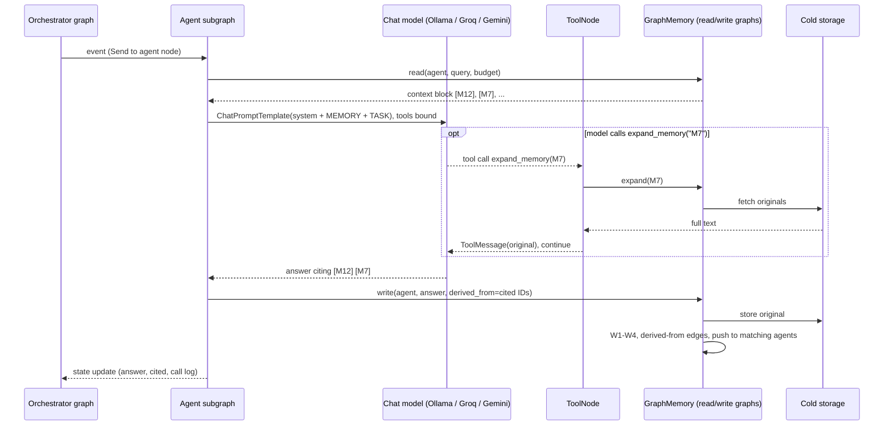

# Graph-Based Context Compression and Explainability in Multi-Agent Systems
## Implementation plan: Part 1 — Shared Graph Memory (slide 13)

This document is the complete build plan for the first part of the methodology: the **shared memory graph** with its **write path**, **read path**, **trace**, **cold storage** and **maintenance job**, plus the multi-agent pipeline that uses it and the experiments that evaluate it.

It is written so that a team member (or a coding assistant) can implement the system module by module, in order, without needing anything else.

> Scope note: slide 14 (Orthogonal BackFill KV-cache compression) is a different method that works on model internals. It is **not** part of this plan.

---

## Contents

1. [What we are building](#1-what-we-are-building)
2. [Overall workflow](#2-overall-workflow)
3. [Tools and their roles](#3-tools-and-their-roles)
4. [Environment setup](#4-environment-setup)
5. [Project structure](#5-project-structure)
6. [Configuration and hyperparameters](#6-configuration-and-hyperparameters)
7. [Data model: the shared memory graph](#7-data-model-the-shared-memory-graph)
8. [Write path (W1–W4)](#8-write-path-w1w4)
9. [Read path (R1–R4)](#9-read-path-r1r4)
10. [Trace, expand and cold storage](#10-trace-expand-and-cold-storage)
11. [Maintenance job](#11-maintenance-job)
12. [Public memory API](#12-public-memory-api)
13. [Multi-agent pipeline (factory diagnosis)](#13-multi-agent-pipeline-factory-diagnosis)
14. [Scenario data generation](#14-scenario-data-generation)
15. [Baselines](#15-baselines)
16. [Experiment harness and logging](#16-experiment-harness-and-logging)
17. [Metrics](#17-metrics)
18. [Ablations](#18-ablations)
19. [Visualisation and demo](#19-visualisation-and-demo)
20. [Testing](#20-testing)
21. [Milestones and timeline](#21-milestones-and-timeline)
22. [Risks and mitigations](#22-risks-and-mitigations) · [Implementation notes](#22a-implementation-notes-changes-made-while-building)
23. [Mapping to objectives and SDG 9](#23-mapping-to-objectives-and-sdg-9)
24. [Glossary](#24-glossary)

---

## 1. What we are building

**Problem.** In a multi-agent LLM system, agents share one flat, growing message history and every agent re-reads all of it on every call. Tokens grow roughly quadratically, relevant facts get diluted, and answers cannot be traced to their source.

**Solution.** Replace the flat history with a **shared memory graph**:

- Every piece of context an agent produces is **compressed**, split into **keywords**, **deduplicated**, and stored as a **memory node** linked to **keyword nodes** and **agent nodes**.
- When an agent needs context, it gets only a **small, ranked, unseen** set of memories that fits a **token budget**, found with **Personalized PageRank** from the query's keywords.
- Every agent output is linked to the memories it used (**derived-from** edges), so any answer can be **traced** back to its facts, the agents that wrote them, and the original text.

**Use case.** Factory fault diagnosis for a small manufacturer, with four agents (as on slide 13): **Sensor**, **History**, **Diagnosis**, **Report**.

**How it is built.** The whole system is a set of nested **LangGraph** graphs:

- an **orchestrator graph** that walks through scenario events and routes each one to an agent;
- one **agent subgraph** per agent (read context → call model → optional tool calls → cite → write);
- three **memory graphs** inside `GraphMemory`: the write path (W1–W4), the read path (R1–R4) and the maintenance job.

Agents talk to models through **LangChain** chat-model interfaces, so each agent can run on a **different provider**: local Ollama models plus free-tier APIs (Groq, Google Gemini, OpenRouter). This makes it a heterogeneous multi-agent system, as a proof of concept, while a single-provider preset is kept for controlled experiments (§13.7).

**Objectives (slide 10) and where they are met.**

| Objective | Mechanism in this plan | Metric |
|---|---|---|
| 1. Represent shared context as a graph | Memory, keyword and agent nodes; written-by, read-by, mentions, derived-from, supersedes edges (§7) | Graph statistics, merge rate |
| 2. Reduce token cost through graph-based filtering | Compression (W1), dedup (W3), PPR ranking + budget + read-by skipping (R2–R3) | Tokens per task, token growth curve |
| 3. Preserve accuracy and traceability | Forced-keep tokens + safety check (W1), cold storage + `expand()`, derived-from + `trace()` | Accuracy, expand rate, trace precision/recall |

---

## 2. Overall workflow

### 2.1 System flow

```mermaid
flowchart TB
    subgraph ORCH[Orchestrator graph - LangGraph StateGraph RunState]
      NE[next_event] -->|route| RW[replay_write]
      NE -->|route| SA[sensor subgraph]
      NE -->|route| HA[history subgraph]
      NE -->|route| DA[diagnosis subgraph]
      DA --> RA[report subgraph]
      RW --> MC{maintain?}
      SA --> MC
      HA --> MC
      RA --> MC
      MC -->|every N turns| MT[maintenance]
      MC -->|no| NE
      MT --> NE
      NE -->|no events left| E((END))
    end

    subgraph AG[Agent subgraph - one per agent, own LLM provider]
      RC[read_context] --> CM[call_model<br/>bind_tools expand_memory, trace_memory]
      CM -->|tools_condition| TN[ToolNode]
      TN --> CM
      CM -->|no tool call| PC[parse_citations] --> WA[write_answer]
    end

    subgraph WRITE[Write graph W1-W4]
      W0[store_original] --> W1[compress<br/>LLMLingua-2 + safety check]
      W1 --> W2[extract + resolve keywords<br/>regex, spaCy, KeyBERT/YAKE, RapidFuzz]
      W2 --> W3a[find + score candidates<br/>weighted Jaccard, cosine, NLI]
      W3a -->|decide| W3m[merge] & W3u[update] & W3c[create]
      W3m & W3u & W3c --> W4[link + notify]
    end

    subgraph READ[Read graph R1-R4]
      R1[match_keywords] -->|seeds found| R2[ppr_rank<br/>Personalized PageRank x strength]
      R1 -->|no seeds| RV[vector_fallback]
      R2 --> R3[fill_budget<br/>skip read, MMR]
      RV --> R3
      R3 --> R4[record_read]
    end

    G[(Shared memory graph<br/>agent / memory / keyword nodes)]
    C[(Cold storage<br/>SQLite originals)]
    CK[(LangGraph checkpoints<br/>SqliteSaver)]

    RC -. GraphMemory.read .-> READ
    WA -. GraphMemory.write .-> WRITE
    RW -. GraphMemory.write .-> WRITE
    TN -. expand / trace .-> C
    W4 --> G
    G --> R1
    W0 -. original text .-> C
    MT -. maintenance graph .-> G
    ORCH -. state after every step .-> CK
```

### 2.2 One agent turn



### 2.3 Worked example (use this in tests and demos)

| Turn | Agent | Content | Keywords |
|---|---|---|---|
| 3 | Sensor | M1: CNC-3 spindle vibration 7.2 mm/s at 14:05, above 6 mm/s limit | cnc-3, spindle, vibration |
| 5 | History | M2: CNC-3 spindle bearing replaced 14 months ago; interval 12 months | cnc-3, spindle, bearing |
| 6 | Sensor | M3: CNC-5 vibration normal | cnc-5, vibration |
| 7 | Sensor | Repeat of M1 from a second report | merged into M1 (no new node) |
| 9 | Diagnosis | Query: "Why is CNC-3 vibrating?" → receives M1, M2 → writes M4: "Likely worn spindle bearing, 2 months overdue" with derived-from M1, M2 | |
| 10 | Report | `trace(M4)` → M1 (Sensor), M2 (History) + original texts | |

Expected PPR shares on the four memories with seeds {cnc-3, vibration}: M1 ≈ 0.39, M2 ≈ 0.32, M3 ≈ 0.29, unrelated ≈ 0. Use this as a regression test (§20).

---

## 3. Tools and their roles

| Tool | Technique | Used in | Role |
|---|---|---|---|
| **LLMLingua-2** (Microsoft) | Token classification (keep/drop) | W1 | Compresses each agent output; keeps numbers, units, negations |
| **spaCy** (`en_core_web_sm`) | NER, PhraseMatcher, lemmatisation | W2, R1 | Entities, domain terms (machines, parts, symptoms), base forms |
| **KeyBERT** (primary) / **YAKE** (fallback, no model) | Keyphrase extraction | W2, R1 | Non-entity key phrases ("overheating", "late delivery") |
| **RapidFuzz** | Fuzzy string matching | W2 | Treats "CNC 3" and "CNC-3" as one keyword |
| **sentence-transformers** (`all-MiniLM-L6-v2`) | Embeddings, cosine similarity | W2, W3, R1, R3 | Synonyms, duplicate meaning check, MMR diversity, fallback retrieval |
| **NLI cross-encoder** (`cross-encoder/nli-deberta-v3-base`) | Natural language inference | W3 | Distinguishes duplicate vs contradiction, so outdated facts are retired |
| **NetworkX** | In-memory graph, Personalized PageRank | Graph, R2 | Prototype graph store and ranking |
| **SQLite** (Python `sqlite3`) | Relational table | W1, `expand()`, `trace()` | Cold storage of original texts |
| **tiktoken** + **HF tokenizer** | Token counting | R3, evaluation | Budget enforcement (tiktoken); exact model input counts (HF tokenizer) |
| **Ollama** + small open model (Qwen2.5 / Llama 3.x) | Local LLM serving | Agents | Runs Sensor/History agents locally and cheaply; fallback for API agents |
| **Groq**, **Google Gemini**, **OpenRouter** (free tiers) | Hosted LLM APIs | Agents | Diagnosis and Report agents on stronger hosted models (§13.7) |
| **LangGraph** `StateGraph`, subgraphs, conditional edges | Graph-based orchestration | Orchestrator, agents, W1–W4, R1–R4, maintenance | Every pipeline in the system is a compiled graph |
| **LangGraph** `ToolNode` + `tools_condition` | Tool-calling loop | Agents | `expand_memory` / `trace_memory` tools instead of parsing `EXPAND(...)` text |
| **langgraph-checkpoint-sqlite** (`SqliteSaver`) | Checkpointing | Orchestrator | Resume runs, time-travel replay when debugging; one thread per (condition, scenario, seed) |
| **LangGraph** `interrupt()` | Human-in-the-loop | Demo | Optional pause before Report so a person can inspect the trace |
| **LangChain** `init_chat_model` + `langchain-ollama`, `langchain-groq`, `langchain-google-genai`, `langchain-openai` | One chat-model interface | Agents | Same code for every provider |
| **LangChain** `@tool` | Tool definitions | Agents | `expand_memory`, `trace_memory` |
| **LangChain** `ChatPromptTemplate` | Prompt templates | Agents | Role prompts (§13.3) |
| **LangChain** `with_structured_output` + pydantic | Structured output | Report agent | Report JSON validated against `ReportSchema` |
| **LangChain** `BaseRetriever` | Retriever interface | Memory, baselines | `GraphMemoryRetriever` and each baseline usable as a standard retriever |
| **langchain-huggingface** + `InMemoryVectorStore` | Vector store | Vector RAG baseline | Same MiniLM embeddings as ours |
| **LangChain** `InMemoryRateLimiter` + fallback chain | Rate limiting, failover | Agents | Stay inside free-tier limits; a `ModelChain` tries primary → Ollama → mock and logs which model answered |
| **LangChain** `SQLiteCache` | LLM response cache | Experiments | Re-runs are identical and cost no API calls |
| **LangChain** `BaseCallbackHandler` | Callbacks | Logging | `CallLogger` writes `calls.jsonl` (tokens, latency, provider) |
| **python-dotenv** | Secrets | Agents | Loads API keys from `.env` |
| **APScheduler** | Scheduled jobs | Maintenance (live mode) | Background decay/archive/merge |
| **pyvis** | Interactive graph HTML | Trace, demo | Visual trace for the evaluation demo |
| **CodeCarbon** | Energy and CO₂ estimation | Evaluation | SDG 9.4 metric |
| **pandas, matplotlib, scipy** | Analysis, plots, statistics | Evaluation | Result tables, charts, significance tests |
| **pytest** | Unit/integration tests | All | Correctness |
| **PyYAML** | Config | All | Hyperparameters in one file |
| *Optional:* **datasketch** | MinHash LSH | W3 | Fast duplicate candidates on large graphs |
| *Optional:* **Neo4j** + GDS | Graph DB, PageRank at scale | Graph, R2 | Scale-up after the prototype |
| *Optional:* **FastAPI** | HTTP API | Integration | Share memory across processes |

---

## 4. Environment setup

**Hardware.** A laptop with 16 GB RAM is enough. A GPU helps (LLMLingua-2, NLI, 7B model) but is not required: use the smaller model variants listed in §6 on CPU.

```powershell
# Windows, Python 3.13 (3.11/3.12 also fine)
cd graphmem-project
py -3.13 -m venv .venv
.venv\Scripts\activate             # Linux/macOS: source .venv/bin/activate

python -m pip install --upgrade pip
pip install -r requirements.txt          # core: LangGraph, LangChain, networkx, ... (runs everything in mock mode)
pip install -r requirements-models.txt   # heavy NLP models: llmlingua, spacy, keybert, sentence-transformers, ...
python -m spacy download en_core_web_sm

# Local LLM (install Ollama from ollama.com first)
ollama pull qwen2.5:7b      # History agent + fallback for API agents
ollama pull qwen2.5:3b      # Sensor agent

# Free-tier API keys (only for the multi_provider preset)
copy .env.example .env      # then fill GROQ_API_KEY, GOOGLE_API_KEY, OPENROUTER_API_KEY

# Freeze exact versions once everything works, for reproducibility
pip freeze > requirements.lock.txt
```

`requirements.txt` (core): `langgraph langgraph-checkpoint-sqlite langchain-core langchain-community langchain-ollama langchain-groq langchain-google-genai langchain-openai python-dotenv networkx numpy scipy rapidfuzz tiktoken yake pyyaml pandas matplotlib pyvis apscheduler pytest tqdm`.

`requirements-models.txt` (optional, heavy): `llmlingua spacy keybert sentence-transformers langchain-huggingface transformers torch codecarbon`.

**Fallbacks.** Every heavy component has a light stand-in, chosen automatically when the package is missing or when `runtime.use_heavy_models: false`. The stand-ins are a rule-based compressor, hashed n-gram embeddings, a heuristic contradiction check, regex + vocabulary keywords, and a deterministic mock LLM. Tests always use the stand-ins, so `pytest` needs neither GPU nor network.

First run with heavy models downloads model weights (LLMLingua-2, MiniLM, NLI cross-encoder, Qwen tokenizer). Run `python -m graphmem.warmup` (§5) once to cache them.

---

## 5. Project structure

```
graphmem-project/
├── config.yaml                    # all hyperparameters (§6)
├── requirements.txt               # core (LangGraph, LangChain, ...)
├── requirements-models.txt        # optional heavy NLP models
├── .env.example                   # API keys template (.env is git-ignored)
├── requirements.lock.txt
├── domain/
│   └── vocabulary.yaml            # machines, components, symptoms, units (§8.2)
├── graphmem/                      # the memory system
│   ├── __init__.py
│   ├── config.py                  # loads config.yaml into dataclasses
│   ├── models.py                  # Memory, Keyword, AgentProfile, ReadResult dataclasses
│   ├── clock.py                   # logical clock (turn counter)
│   ├── tokens.py                  # tiktoken + HF tokenizer helpers
│   ├── embed.py                   # shared SentenceTransformer, cached embeddings
│   ├── compress.py                # W1
│   ├── keywords.py                # W2 extraction
│   ├── resolve.py                 # W2 normalisation + keyword resolution
│   ├── merge.py                   # W3
│   ├── notify.py                  # W4 need profiles + push inbox
│   ├── graph_store.py             # NetworkX wrapper: typed nodes/edges, retrieval view
│   ├── cold_store.py              # SQLite originals
│   ├── retrieve.py                # R1–R3
│   ├── trace.py                   # trace()
│   ├── maintenance.py             # decay, archive, keyword merge (step functions)
│   ├── nli.py                     # NLI cross-encoder + heuristic fallback
│   ├── graphs/                    # LangGraph pipelines over the steps above
│   │   ├── write_graph.py         # W1-W4 StateGraph (merge/update/create branch)
│   │   ├── read_graph.py          # R1-R4 StateGraph (PPR or vector fallback branch)
│   │   └── maintain_graph.py      # archive -> merge keywords -> cleanup -> stats
│   ├── lc.py                      # LangChain: GraphMemoryRetriever, expand/trace @tools
│   ├── memory.py                  # GraphMemory facade: invokes the compiled graphs
│   └── warmup.py                  # downloads/caches all models
├── agents/
│   ├── prompts.py                 # ChatPromptTemplates for the 4 agents
│   ├── schemas.py                 # pydantic ReportSchema (structured output)
│   ├── models.py                  # provider factory: init_chat_model, rate limits, fallbacks, cache
│   ├── mock_llm.py                # deterministic rule-based BaseChatModel (tests, offline)
│   ├── callbacks.py               # CallLogger(BaseCallbackHandler) -> calls.jsonl
│   └── graph.py                   # agent subgraph + orchestrator StateGraph + checkpointer
├── baselines/
│   ├── base.py                    # MemoryBackend interface
│   ├── full_history.py
│   ├── sliding_window.py
│   ├── rolling_summary.py
│   └── vector_rag.py
├── data/
│   ├── schema.json                # scenario JSON schema (§14)
│   ├── simulator.py               # deterministic event + ground-truth generator
│   ├── paraphrase.py              # optional LLM rewording of events
│   └── scenarios/                 # generated scenario files
├── eval/
│   ├── run_experiment.py          # runs conditions x scenarios x seeds
│   ├── metrics.py                 # §17
│   ├── stats.py                   # significance tests
│   └── plots.py
├── viz/
│   └── trace_view.py              # pyvis HTML export
├── results/                       # JSONL logs, CSVs, plots (git-ignored)
└── tests/
    ├── test_compress.py
    ├── test_keywords.py
    ├── test_merge.py
    ├── test_retrieve.py
    ├── test_trace.py
    └── test_end_to_end.py
```

---

## 6. Configuration and hyperparameters

All tunable values live in `config.yaml`. Defaults below are starting points; tune on a held-out set of scenarios, never on the test set. The `graphmem-project/config.yaml` in the repository is the source of truth: it adds the keys introduced during implementation (see §22a), e.g. `retrieval.skip_read_window`, `merge.jaccard_kinds`, `hash_embedding_overrides`, and the dev-tuned `strength.decay_lambda: 0.02`.

```yaml
seed: 42

runtime:
  use_heavy_models: auto           # auto | true | false  (false = light fallbacks, §4)
  checkpoint_db: results/checkpoints.sqlite
  llm_cache: results/llm_cache.sqlite

clock:
  unit: turn                       # logical time; 1 agent message = 1 turn

compression:                       # W1
  model: microsoft/llmlingua-2-xlm-roberta-large-meetingbank
  model_small: microsoft/llmlingua-2-bert-base-multilingual-cased-meetingbank
  use_small_model: false           # true on CPU-only laptops
  rate: 0.5                        # keep ~50% of tokens
  min_tokens_to_compress: 25       # shorter texts are stored as-is
  force_tokens: ["not", "no", "never", "none", "without", "before", "after",
                 "above", "below", "%", "\n"]
  force_reserve_digit: true
  safety_check: true               # §8.1 fallback if numbers/negations dropped
  fallback_rate_step: 0.2

keywords:                          # W2
  spacy_model: en_core_web_sm
  ner_labels: [ORG, PRODUCT, FAC, GPE, PERSON, EVENT, LAW]
  keybert_top_n: 5
  keybert_ngram: [1, 2]
  keybert_use_mmr: true
  keybert_diversity: 0.5
  use_yake_fallback: true
  max_keywords_per_memory: 8

resolution:                        # W2 keyword matching
  fuzzy_threshold: 90              # RapidFuzz ratio 0-100
  embed_threshold: 0.85            # cosine
  digit_guard: true                # never merge keywords whose digits differ

embeddings:
  model: sentence-transformers/all-MiniLM-L6-v2
  normalize: true

merge:                             # W3
  candidate_min_shared_keywords: 1
  jaccard_skip_below: 0.3
  jaccard_merge: 0.6
  cosine_merge: 0.90
  cosine_update: 0.80
  nli_model: cross-encoder/nli-deberta-v3-base
  nli_model_small: cross-encoder/nli-deberta-v3-xsmall
  nli_contradiction_update: 0.70
  nli_contradiction_block_merge: 0.50
  merge_strength_boost: 0.2

notify:                            # W4
  enabled: true
  profile_match_threshold: 0.25    # weighted overlap with need profile
  profile_learning: true           # add keywords of cited memories to profile
  profile_max_size: 40

retrieval:                         # R1-R3
  ppr_alpha: 0.85                  # continue probability (restart = 0.15)
  seed_weight_query: 1.0
  seed_weight_profile: 0.2
  seed_weight_inbox: 0.5
  ego_radius: 4                    # compute PPR on a local subgraph
  fallback_embed_top_k: 3          # query keywords with no exact match
  fallback_embed_min_cos: 0.60
  vector_fallback_top_k: 10        # if no seed at all
  mmr_lambda: 0.7
  token_budget_default: 300
  skip_already_read: true
  include_superseded: false

strength:                          # used in R2 and maintenance
  initial: 1.0
  read_boost: 0.1
  max: 2.0
  decay_lambda: 0.05               # per turn
  archive_below: 0.10

maintenance:
  every_n_turns: 10                # deterministic in experiments
  keyword_merge_cosine: 0.92

agents:
  preset: mock                     # mock | single_provider | multi_provider  (§13.7)
  temperature: 0.0
  num_ctx: 8192
  max_expand_per_turn: 1
  token_counter: tiktoken:cl100k_base     # ONE fixed tokenizer for the primary token metric
  presets:
    single_provider:               # controlled experiments: every agent on the same local model
      default: {provider: ollama, model: qwen2.5:7b}
    multi_provider:                # proof of concept: heterogeneous agents
      sensor:    {provider: ollama, model: qwen2.5:3b}
      history:   {provider: ollama, model: qwen2.5:7b}
      diagnosis: {provider: groq,   model: llama-3.3-70b-versatile}
      report:    {provider: google_genai, model: gemini-2.0-flash}
      summariser: {provider: ollama, model: qwen2.5:3b}
    fallbacks:                     # tried in order if the primary model fails
      - {provider: ollama, model: qwen2.5:7b}
      - {provider: mock}
  rate_limits:                     # requests/second per provider (free tiers)
    groq: 0.5
    google_genai: 0.25
    openrouter: 0.3
    ollama: 0

experiment:
  mode: replay                     # replay | live (§13.4)
  seeds: [42, 43, 44]
  sliding_window_n: 10
  rolling_summary_every: 8
  vector_rag_top_k: 8
```

---

## 7. Data model: the shared memory graph

Implemented as a `networkx.MultiDiGraph` (all node/edge types) plus a separate undirected **retrieval view** (`networkx.Graph`) that holds only active memory and keyword nodes, used for PageRank.

### 7.1 Nodes

**AgentNode** — `id = "A:<name>"`

| Attribute | Type | Description |
|---|---|---|
| `type` | `"agent"` | |
| `name` | str | `sensor`, `history`, `diagnosis`, `report` |
| `role` | str | Role description (from prompt) |
| `profile` | dict[str, float] | Need profile: keyword → weight |
| `inbox` | list[str] | Memory IDs pushed but not yet delivered |

**MemoryNode** — `id = "M<int>"`

| Attribute | Type | Description |
|---|---|---|
| `type` | `"memory"` | |
| `text` | str | Compressed text (what agents see) |
| `tokens` | int | Token count of `text` (tiktoken) |
| `orig_tokens` | int | Token count of original |
| `cold_id` | int | Row ID in SQLite |
| `kind` | str | `observation` (from data) or `derived` (agent conclusion) |
| `embedding` | np.ndarray | MiniLM vector of `text` (kept in a side cache, not on the node, for speed) |
| `created_at` | int | Turn created |
| `last_used` | int | Turn last read |
| `use_count` | int | Times delivered |
| `base_strength` | float | Strength at `last_used` |
| `valid_from` | int | Turn |
| `valid_until` | int or None | Set when superseded |
| `archived` | bool | True after archiving |
| `n_writers` | int | Number of agents who reported it (agreement) |

Effective strength at time `t`:
`strength(t) = base_strength × exp(−λ × (t − last_used))`

**KeywordNode** — `id = "K:<canonical>"`

| Attribute | Type | Description |
|---|---|---|
| `type` | `"keyword"` | |
| `canonical` | str | e.g. `cnc-3`, `spindle bearing` |
| `aliases` | set[str] | Surface forms seen |
| `kind` | str | `machine`, `component`, `symptom`, `entity`, `phrase` |
| `df` | int | Number of active memories mentioning it |
| `embedding` | np.ndarray | MiniLM vector (side cache) |

### 7.2 Edges

| Edge (`key`) | From → To | Attributes | Purpose |
|---|---|---|---|
| `written_by` | Memory → Agent | `turn` | Provenance; agreement count |
| `sent_to` | Memory → Agent | `turn` | Push notification (W4) |
| `read_by` | Memory → Agent | `turn` | Never resend; "unnecessary context" metric |
| `mentions` | Memory → Keyword | `weight` = IDF(k) | Linking, dedup, retrieval |
| `derived_from` | Memory → Memory | `turn` | Explainability (`trace()`) |
| `supersedes` | Memory → Memory | `turn` | New fact replaces contradicted old fact |

IDF weight: `idf(k) = ln((N + 1) / (df(k) + 1)) + 1`, where `N` = number of active memories. Recompute lazily during maintenance; use the current value at retrieval time.

### 7.3 Retrieval view

An undirected `nx.Graph` containing only **active** (not archived, not superseded) memories and their keywords, with edge `weight = idf(k)`. Updated on every write, supersede and archive. Agent nodes are **not** in this view; agent preferences enter PageRank through seeds (§9.2).

### 7.4 Cold storage schema (SQLite)

```sql
CREATE TABLE originals (
  id          INTEGER PRIMARY KEY AUTOINCREMENT,
  memory_id   TEXT,          -- filled after W3 decides (may point to a merged memory)
  agent       TEXT NOT NULL,
  turn        INTEGER NOT NULL,
  text        TEXT NOT NULL,
  scenario_id TEXT,
  event_id    TEXT           -- links back to the scenario event (for evaluation)
);
CREATE INDEX idx_originals_memory ON originals(memory_id);
```

A merged memory has **several** originals (one per report); all are returned by `expand()`.

---

## 8. Write path (W1–W4)

Entry point: `GraphMemory.write(agent, text, recipients=None, derived_from=None, event_id=None) -> memory_id`

The write path is a compiled LangGraph `StateGraph(WriteState)` (`graphmem/graphs/write_graph.py`). Each W-step below is one node (a plain Python function in its own module, so it can be unit-tested without LangGraph). The merge decision is a conditional edge.

```python
# graphmem/graphs/write_graph.py
class WriteState(TypedDict, total=False):
    agent: str; text: str; recipients: list[str]; derived_from: list[str]; event_id: str
    cold_id: int; compressed: str; comp_meta: dict
    keyword_ids: list[str]; candidates: list[dict]; best: dict
    decision: Literal["merge", "update", "create"]; memory_id: str; notified: list[str]

def build_write_graph(mem):
    g = StateGraph(WriteState)
    g.add_node("store_original",  lambda s: {"cold_id": mem.cold.add(s["agent"], mem.clock.now, s["text"], s.get("event_id"))})
    g.add_node("compress",         mem.steps.compress)          # W1
    g.add_node("extract_keywords", mem.steps.extract_keywords)  # W2 (extract + resolve)
    g.add_node("score_candidates", mem.steps.score_candidates)  # W3 candidates + J / cos / NLI
    g.add_node("merge",  mem.steps.merge)                       # W3 actions
    g.add_node("update", mem.steps.update)
    g.add_node("create", mem.steps.create)
    g.add_node("link_notify", mem.steps.link_notify)            # W4
    g.add_edge(START, "store_original"); g.add_edge("store_original", "compress")
    g.add_edge("compress", "extract_keywords"); g.add_edge("extract_keywords", "score_candidates")
    g.add_conditional_edges("score_candidates", lambda s: s["decision"], ["merge", "update", "create"])
    for n in ["merge", "update", "create"]:
        g.add_edge(n, "link_notify")
    g.add_edge("link_notify", END)
    return g.compile()
```

### 8.1 W1 — Compress (LLMLingua-2)

**Steps**
1. Save the original to cold storage first (always).
2. If `tokens(text) < min_tokens_to_compress`, keep text as-is.
3. Otherwise compress with LLMLingua-2 at `rate`, with `force_tokens` and `force_reserve_digit`.
4. **Safety check** (our addition): every number and every negation word in the original must appear in the compressed text. If not, retry with `rate + fallback_rate_step`; if it still fails, store the original uncompressed. Log the fallback (it feeds the expand-rate analysis).

```python
# graphmem/compress.py
import re
from llmlingua import PromptCompressor

NEG = {"not", "no", "never", "none", "without", "n't"}
NUM = re.compile(r"\d+(?:\.\d+)?")

class Compressor:
    def __init__(self, cfg, count_tokens):
        model = cfg.model_small if cfg.use_small_model else cfg.model
        self.pc = PromptCompressor(model_name=model, use_llmlingua2=True, device_map="cpu")
        self.cfg, self.count = cfg, count_tokens

    def _safe(self, orig, comp):
        nums_ok = set(NUM.findall(orig)) <= set(NUM.findall(comp))
        negs = {w for w in re.findall(r"[a-z']+", orig.lower()) if w in NEG}
        negs_ok = all(n in comp.lower() for n in negs)
        return nums_ok and negs_ok

    def __call__(self, text) -> tuple[str, dict]:
        if self.count(text) < self.cfg.min_tokens_to_compress:
            return text, {"compressed": False}
        rate = self.cfg.rate
        while rate <= 1.0:
            out = self.pc.compress_prompt(
                text, rate=rate,
                force_tokens=self.cfg.force_tokens,
                force_reserve_digit=self.cfg.force_reserve_digit,
                drop_consecutive=True)
            comp = out["compressed_prompt"]
            if not self.cfg.safety_check or self._safe(text, comp):
                return comp, {"compressed": True, "rate": rate}
            rate += self.cfg.fallback_rate_step
        return text, {"compressed": False, "fallback": True}
```

**Output:** compressed text, token counts, metadata.

### 8.2 W2 — Extract and normalise keywords

**Extraction (union of four sources, then capped at `max_keywords_per_memory`):**

1. **Regex for domain IDs** — machines, part numbers, purchase orders. spaCy's NER does not recognise IDs like `CNC-3`, so do this first.
   ```python
   ID_PATTERNS = {
       "machine": re.compile(r"\b([A-Z]{2,5})[\s\-]?(\d{1,4})\b"),     # CNC-3, CNC 3, VMC12
       "po":      re.compile(r"\bPO[\s\-]?(\d{3,6})\b", re.I),
   }
   # canonical form: lowercase letters + "-" + digits  ->  "cnc-3"
   ```
2. **spaCy PhraseMatcher** with `domain/vocabulary.yaml` (components, symptoms, units):
   ```yaml
   components: [spindle, spindle bearing, bearing, coolant pump, servo motor, ball screw, belt, gearbox, chuck]
   symptoms:   [vibration, overheating, noise, chatter, leakage, misalignment, wear, tool breakage]
   ```
   Match on `LOWER` attribute; canonical = lemma of the matched phrase.
3. **spaCy NER** — keep labels in `ner_labels` (organisations, products, facilities, people). Drop numbers, dates, quantities (they stay in the text, not as keywords).
4. **KeyBERT** (reusing the same MiniLM model) for remaining key phrases; **YAKE** if KeyBERT returns nothing.
   ```python
   kb = KeyBERT(model=shared_sentence_transformer)
   phrases = kb.extract_keywords(text, keyphrase_ngram_range=(1, 2), stop_words="english",
                                 top_n=5, use_mmr=True, diversity=0.5)
   ```

**Normalisation:** lowercase → strip punctuation → spaCy lemma per token → collapse whitespace. IDs use their canonical form (`cnc-3`).

**Resolution to an existing keyword node (in this order):**

1. Exact match on canonical or alias.
2. RapidFuzz on compact forms (remove non-alphanumerics), `fuzz.ratio ≥ 90`.
3. Embedding cosine ≥ 0.85 against existing keyword embeddings (numpy matrix dot product).
4. Otherwise create a new keyword node.

**Digit guard (important):** never match two keywords whose digit sequences differ. Without it, `cnc-3` and `cnc-5` match on both fuzzy ratio and embeddings.

```python
def digits(s): return re.findall(r"\d+", s)

def resolve(term, index):
    if term in index.alias_map:                          # 1 exact
        return index.alias_map[term]
    compact = re.sub(r"[^a-z0-9]", "", term)
    hit = process.extractOne(compact, index.compact_choices, scorer=fuzz.ratio,
                             score_cutoff=cfg.fuzzy_threshold)          # 2 fuzzy
    if hit and digits(term) == digits(index.compact_to_kw[hit[0]]):
        return index.compact_to_kw[hit[0]]
    sims = index.emb_matrix @ embed(term)                                # 3 embeddings
    j = int(sims.argmax()) if len(sims) else -1
    if j >= 0 and sims[j] >= cfg.embed_threshold and digits(term) == digits(index.ids[j]):
        return index.ids[j]
    return index.create(term)                                            # 4 new
```

**Output:** list of keyword node IDs for this memory.

### 8.3 W3 — Merge or create

**Candidates:** active memories that share at least one keyword with the new memory (graph lookup through keyword nodes; no full scan). Use datasketch MinHash LSH only if the graph exceeds ~50k memories.

**Scores per candidate `c`:**
- Weighted Jaccard over keyword sets with IDF weights:
  `J(A, B) = Σ_{k ∈ A∩B} idf(k) / Σ_{k ∈ A∪B} idf(k)`
- Cosine similarity of MiniLM embeddings of the compressed texts.
- NLI contradiction probability, computed **both directions** and taking the max. For `cross-encoder/nli-deberta-v3-base` the output order is `[contradiction, entailment, neutral]`; apply softmax.

**Decision rule** (best candidate = highest `0.5·J + 0.5·cos`):

| Condition | Action |
|---|---|
| `J ≥ 0.6` and `cos ≥ 0.90` and `p_contra < 0.5` | **MERGE**: add `written_by` edge for the new agent, `n_writers += 1`, `base_strength += 0.2` (cap 2.0), link the original in cold storage to this memory. No new node. |
| (`J ≥ 0.6` or `cos ≥ 0.80`) and `p_contra ≥ 0.7` | **UPDATE**: create a new memory, add `supersedes` edge new → old, set old `valid_until = now`, remove old from the retrieval view. |
| otherwise | **CREATE**: new memory node. |

```python
def nli_contradiction(a, b):
    logits = nli.predict([(a, b), (b, a)])          # shape (2, 3)
    probs = softmax(logits, axis=1)
    return float(probs[:, 0].max())                 # index 0 = contradiction
```

**Known limitation to note in the report:** a new sensor reading for the same machine (7.2 → 8.1 mm/s) is usually classified as a contradiction and supersedes the old reading. For "latest state" facts this is the desired behaviour. If trend history matters for a scenario, mark readings as `kind="observation_series"` and skip UPDATE for them.

### 8.4 W4 — Link and notify

1. Add edges: `written_by` (memory → writer agent), `mentions` (memory → each keyword, weight = IDF), `derived_from` (memory → each cited memory, if provided).
2. Update keyword `df`, the retrieval view, and the embedding caches.
3. **Push notification:** for every agent other than the writer, compute the weighted overlap between the memory's keywords and the agent's need profile:
   `match(m, a) = Σ_{k ∈ K(m)} profile_a[k] · idf(k) / Σ_{k ∈ K(m)} idf(k)`
   If `match ≥ profile_match_threshold`, add the memory ID to the agent's `inbox` and add a `sent_to` edge. If `recipients` is passed explicitly, those agents are always notified.
4. **Need profiles:** initialised from role keywords (§13.2). With `profile_learning`, after each agent turn the keywords of the memories it **cited** are added to its profile with weight 0.1 (capped at 1.0; profile limited to `profile_max_size`, lowest weights dropped).

Pushed memories are not sent as text immediately; they are boosted at the agent's next `read()` (§9.2). This keeps all context delivery inside one token budget.

---

## 9. Read path (R1–R4)

Entry point: `GraphMemory.read(agent, query, token_budget=300) -> ReadResult`

The read path is a compiled `StateGraph(ReadState)` (`graphmem/graphs/read_graph.py`):

```
START -> match_keywords --(seeds found)--> ppr_rank --------> fill_budget -> record_read -> END
                        \--(no seeds)---> vector_fallback --/
```

`GraphMemory.read()` invokes it and converts the final state into a `ReadResult`. The same object is also exposed as a LangChain retriever (`GraphMemoryRetriever(BaseRetriever)` in `graphmem/lc.py`), which returns one `Document` per delivered memory with `metadata={"id", "agent", "turn", "score"}`.

### 9.1 R1 — Match query keywords

1. Run the same extraction and normalisation as W2 on the query.
2. Resolve each query term with **exact → fuzzy → embedding** (same digit guard), but **do not create** new keyword nodes.
3. For terms with no match, take the top `fallback_embed_top_k` keyword nodes with cosine ≥ `fallback_embed_min_cos` as weaker seeds (weight × cosine).
4. If no seed is found at all, skip to the **vector fallback**: rank active memories by cosine to the query embedding and go to R3.

### 9.2 R2 — Spread and rank (Personalized PageRank × strength)

**Seeds (personalization vector):**
- query keyword nodes: `seed_weight_query` (1.0)
- the agent's need-profile keywords present in the graph: `seed_weight_profile × profile weight` (0.2 ×)
- memories in the agent's inbox: `seed_weight_inbox` (0.5)

**Run PPR** on the retrieval view, restricted to the ego subgraph within `ego_radius` hops of the seeds (keeps cost proportional to the neighbourhood, not the whole graph):

```python
# graphmem/retrieve.py
import networkx as nx

def rank(view, seeds: dict[str, float], strength, now, cfg):
    nodes = set()
    for s in seeds:
        if s in view:
            nodes |= set(nx.single_source_shortest_path_length(view, s, cutoff=cfg.ego_radius))
    sub = view.subgraph(nodes)
    pers = {n: w for n, w in seeds.items() if n in sub}
    if not pers:
        return []
    pr = nx.pagerank(sub, alpha=cfg.ppr_alpha, personalization=pers, weight="weight")
    scored = [(m, pr[m] * strength(m, now))
              for m in sub if sub.nodes[m]["type"] == "memory"]
    return sorted(scored, key=lambda x: x[1], reverse=True)
```

`nx.pagerank` normalises the personalization vector itself; nodes absent from it get zero restart probability.

### 9.3 R3 — Fill the token budget

1. Drop memories already `read_by` this agent (if `skip_already_read`), superseded memories (unless `include_superseded`), and archived memories.
2. **MMR selection** to avoid near-duplicates using up the budget:
   `pick argmax_m [ λ · score_norm(m) − (1 − λ) · max_{s ∈ selected} cos(m, s) ]`, λ = 0.7.
3. Format each memory as one line:
   `[M12 | sensor | t=3] CNC-3 spindle vibration 7.2 mm/s 14:05, above limit 6 mm/s`
4. Add lines in MMR order while the running tiktoken count ≤ `token_budget`. Always include the first item if it fits on its own.
5. Return `ReadResult(memory_ids, context_text, tokens_used, scores, seeds_used)`.

### 9.4 R4 — Record what was used

- On delivery: add `read_by` edges (memory → agent, turn), `last_used = now`, `use_count += 1`, `base_strength = min(max, strength(now) + read_boost)`, remove delivered IDs from the inbox.
- After the agent answers, its subgraph's `write_answer` node calls `write(agent, answer, derived_from=cited_ids)`.
  - Agents are instructed to cite memory IDs in square brackets (§13.3). Parse them with `re.findall(r"\[(M\d+)\]", answer)` (the Report agent's structured `evidence` field is used directly).
  - `cited_ids = parsed ∩ delivered`. If the agent cites nothing, fall back to all delivered IDs and flag the turn (`citation_missing=True`) for analysis.
  - `delivered − cited` is logged as **unnecessary context** (§17).

---

## 10. Trace, expand and cold storage

### 10.1 `expand(memory_id) -> list[dict]`
Returns all original texts for that memory from SQLite (several if it was merged), with agent and turn. Increments an `expand_count` counter (expand rate metric).

Both `expand` and `trace` are also exposed to the agents as LangChain tools (`graphmem/lc.py`), built per memory backend:

```python
def make_memory_tools(memory):
    @tool
    def expand_memory(memory_id: str) -> str:
        """Return the full original text(s) of a memory, e.g. 'M7', when its compressed text is incomplete."""
        return "\n".join(f"[{o['agent']} t={o['turn']}] {o['text']}" for o in memory.expand(memory_id))

    @tool
    def trace_memory(memory_id: str) -> str:
        """Return the provenance tree of a memory: which facts and agents it was derived from."""
        return json.dumps(memory.trace(memory_id), default=str)[:4000]
    return [expand_memory, trace_memory]
```

Agents call them through LangGraph's `ToolNode` (§13.5). Backends without cold storage (baselines) return an explanatory string.

### 10.2 `trace(memory_id, max_depth=6) -> dict`
Breadth-first walk over `derived_from` edges, then `written_by` for each node, then cold storage for the originals.

```python
def trace(g, cold, mid, max_depth=6):
    def node(m, depth):
        writers = [v.split(":")[1] for _, v, k in g.out_edges(m, keys=True) if k == "written_by"]
        parents = [v for _, v, k in g.out_edges(m, keys=True) if k == "derived_from"]
        return {
            "id": m, "text": g.nodes[m]["text"], "agents": writers,
            "kind": g.nodes[m]["kind"],
            "originals": cold.get(m),
            "superseded": g.nodes[m]["valid_until"] is not None,
            "sources": [node(p, depth + 1) for p in parents] if depth < max_depth else [],
        }
    return node(mid, 0)
```

The leaves of the trace are observations; their `event_id`s are compared with the scenario's gold supporting events for trace precision/recall (§17).

---

## 11. Maintenance job

Runs every `every_n_turns` turns in experiments (deterministic), or on an APScheduler `BackgroundScheduler` interval in live/demo mode. In experiments it is triggered by the orchestrator graph's `maintain?` conditional edge (§13.5).

It is a compiled linear `StateGraph(MaintainState)` (`graphmem/graphs/maintain_graph.py`): `archive → merge_keywords → cleanup → log_stats → END`, each node returning counts that are merged into the final stats dict.

1. **Decay:** nothing to write (strength is computed lazily from `base_strength` and `last_used`).
2. **Archive:** for every active memory with `strength(now) < archive_below`, set `archived = True`, remove it from the retrieval view, decrement keyword `df`. Cold storage keeps the original; `trace()` still works on archived memories.
3. **Keyword merge:** pairwise cosine between keyword embeddings (only pairs that share a memory neighbour, to keep it cheap); merge pairs with cosine ≥ 0.92 that pass the digit guard. Redirect `mentions` edges, union aliases.
4. **Cleanup:** delete keyword nodes with `df == 0`; recompute IDF weights on the retrieval view.
5. Log graph statistics (nodes by type, edges by type, stored tokens) for the storage metric.

```python
from apscheduler.schedulers.background import BackgroundScheduler
sched = BackgroundScheduler()
sched.add_job(lambda: memory.maintain(), "interval", seconds=60)   # demo mode only
sched.start()
```

---

## 12. Public memory API

```python
class GraphMemory:
    def __init__(self, cfg, db_path="results/cold.sqlite"): ...

    # core
    def write(self, agent: str, text: str, recipients: list[str] | None = None,
              derived_from: list[str] | None = None, event_id: str | None = None) -> str: ...
    def read(self, agent: str, query: str, token_budget: int | None = None) -> ReadResult: ...
    def expand(self, memory_id: str) -> list[dict]: ...
    def trace(self, memory_id: str) -> dict: ...

    # housekeeping
    def register_agent(self, name: str, role: str, profile_keywords: list[str]) -> None: ...
    def maintain(self) -> dict: ...
    def tick(self) -> int: ...            # advance logical clock
    def stats(self) -> dict: ...          # node/edge counts, stored tokens, merge counts
    def export_graph(self, path: str): ...# GraphML for inspection
```

All baselines implement the same `MemoryBackend` interface (`write`, `read`, `register_agent`, `stats`), so the agent pipeline is identical across conditions.

---

## 13. Multi-agent pipeline (factory diagnosis)

### 13.1 Design principle
**Only the memory backend changes between experimental conditions.** Same agents, same prompts, same LLM, same temperature (0), same seeds. Memory is called by the orchestrator in code, not by the LLM as an optional tool, so every condition gets context the same way. (The only LLM-initiated memory calls are the `expand_memory` / `trace_memory` tools.) Each agent may use a different model and provider (§13.7), but the role-to-model assignment is fixed across conditions.

### 13.2 Agents

| Agent | Triggered by | Writes | Initial need-profile keywords |
|---|---|---|---|
| **Sensor** | sensor reading events | anomaly reports | vibration, temperature, current, pressure, limit, threshold, machine IDs |
| **History** | maintenance log / spec events, history questions | maintenance facts | maintenance, replaced, interval, service, component names |
| **Diagnosis** | diagnostic questions | root-cause conclusions | all symptoms, all components, maintenance, overdue |
| **Report** | after each diagnosis | final structured answer (JSON) | root cause, action, machine IDs |

### 13.3 Prompt contract (all agents)

Implemented as a LangChain `ChatPromptTemplate` in `agents/prompts.py`:

```python
AGENT_PROMPT = ChatPromptTemplate.from_messages([
    ("system",
     "You are the {role} agent in a factory maintenance team. {role_description}\n"
     "Use only the facts in MEMORY. Each fact starts with an ID like [M12].\n"
     "Cite the IDs of every fact you use, in square brackets.\n"
     "If a fact looks incomplete and you need its full original text, call the expand_memory tool."),
    ("human", "MEMORY:\n{context}\n\nTASK:\n{task}"),
    MessagesPlaceholder("scratch"),       # tool calls + ToolMessages within this turn
])
```

The Report agent must answer in JSON so scoring is deterministic. It uses `llm.with_structured_output(ReportSchema)` (pydantic, `agents/schemas.py`), with a JSON-parse fallback for models that do not support structured output:

```json
{"machine": "cnc-3", "root_cause": "bearing_wear", "action": "replace spindle bearing",
 "evidence": ["M1", "M2", "M4"]}
```

`root_cause` comes from a fixed label set: `bearing_wear, misalignment, imbalance, coolant_failure, overload, lubrication_failure, sensor_fault, belt_wear, none`.

### 13.4 Two run modes

| Mode | What runs live | Use for |
|---|---|---|
| **replay** (default) | Sensor/History messages are pre-generated text from the scenario and written straight into memory; only Diagnosis and Report call the LLM | Main experiments: identical inputs for every condition, about 10× fewer LLM calls |
| **live** | Every agent calls the LLM on every event | Small-scale run to measure the full token growth including Sensor/History re-reading |

### 13.5 LangGraph wiring (`agents/graph.py`)

Two levels: an **agent subgraph** (one compiled graph, parameterised by agent name) and the **orchestrator graph** that runs a whole scenario. The memory backend, models and loggers are passed at run time through `config["configurable"]`, so the same compiled graphs serve every experimental condition.

**Agent subgraph**

```python
class AgentState(TypedDict, total=False):
    agent: str; event: dict
    context: dict                                   # ReadResult as dict
    messages: Annotated[list[AnyMessage], add_messages]   # prompt + tool calls + ToolMessages
    n_tool_calls: int
    answer: str; report: dict | None; cited: list[str]; memory_id: str

def build_agent_graph():
    g = StateGraph(AgentState)
    g.add_node("read_context", read_context)        # memory.read(agent, task, budget)
    g.add_node("call_model", call_model)            # prompt | llm.bind_tools([expand_memory, trace_memory])
    g.add_node("tools", run_tools)                  # ToolNode over the backend's memory tools
    g.add_node("parse_citations", parse_citations)  # [Mx] ∩ delivered, or structured evidence
    g.add_node("write_answer", write_answer)        # memory.write(agent, answer, derived_from=cited)
    g.add_edge(START, "read_context"); g.add_edge("read_context", "call_model")
    g.add_conditional_edges("call_model", route_tools,       # tools_condition + max_expand_per_turn cap
                            {"tools": "tools", "done": "parse_citations"})
    g.add_edge("tools", "call_model")
    g.add_edge("parse_citations", "write_answer"); g.add_edge("write_answer", END)
    return g.compile()
```

The Report agent skips the tool loop: it makes one `with_structured_output(ReportSchema)` call (falling back to plain text + JSON parsing if a provider rejects structured output). It receives the Diagnosis answer as an explicit hand-off line `[M_d | diagnosis | t=...]` in front of its memory context, identically in every condition.

**Orchestrator graph**

```python
class RunState(TypedDict, total=False):
    events: list[dict]; i: int; turn: int
    answers: Annotated[list[dict], operator.add]     # Report JSON + gold per question
    last: dict                                       # last agent output (for the Report step)

def route_event(s):
    if s["i"] >= len(s["events"]): return "end"
    ev = s["events"][s["i"]]
    if mode == "replay" and ev["type"] != "question": return "replay_write"
    return {"sensor_reading": "sensor", "maintenance": "history", "spec": "history",
            "operator_note": "sensor", "question": "diagnosis"}[ev["type"]]

def build_orchestrator(checkpointer=None):
    agent = build_agent_graph()
    g = StateGraph(RunState)
    g.add_node("next_event", next_event)             # memory.tick(), advance turn
    g.add_node("replay_write", replay_write)         # memory.write(source_agent, text, event_id)
    for name in ["sensor", "history", "diagnosis", "report"]:
        g.add_node(name, make_agent_runner(agent, name))   # invokes the agent subgraph
    g.add_node("maintenance", maintenance)           # memory.maintain() -> maintenance graph
    g.add_edge(START, "next_event")
    g.add_conditional_edges("next_event", route_event,
        {"replay_write": "replay_write", "sensor": "sensor", "history": "history",
         "diagnosis": "diagnosis", "end": END})
    g.add_edge("diagnosis", "report")                # every diagnosis is followed by a report
    for n in ["replay_write", "sensor", "history", "report"]:
        g.add_conditional_edges(n, maybe_maintain, {"maintenance": "maintenance", "next": "next_event"})
    g.add_edge("maintenance", "next_event")
    return g.compile(checkpointer=checkpointer)

app = build_orchestrator(checkpointer=SqliteSaver(conn))
app.invoke({"events": scenario["events"], "i": 0, "turn": 0, "answers": []},
           config={"configurable": {"thread_id": f"{cond}-{sid}-{seed}", "memory": backend,
                                    "models": models, "logger": call_logger},
                   "recursion_limit": 10 * len(scenario["events"]) + 50,
                   "callbacks": [call_logger]})
```

- Each run is one checkpoint **thread**. `app.get_state_history(config)` lets you step back through every orchestrator step (delivered context, answers, maintenance logs) while debugging. The memory graph itself lives in the backend object, not in the checkpoint; persist it with `export_graph()` if a run must be resumed in a new process.
- The demo uses `app.stream(..., stream_mode="updates")` to show tokens per agent live.
- Optional human-in-the-loop: with `demo.interrupt_before_report: true`, the `report` runner calls `interrupt({"trace": ...})` and resumes with `Command(resume=...)`.

### 13.6 Models, logging and token counting (`agents/models.py`, `agents/callbacks.py`)
- `get_models(cfg, preset)` returns one `ModelChain` per agent role. Each model in it is built with `init_chat_model(model, model_provider=provider, temperature=0, rate_limiter=...)`. The chain tries the primary, then the configured fallbacks, binding tools or structured output per call. Models that cannot work (missing key, package, or Ollama server) are skipped at build time with a logged reason, and `fallback_used` is recorded per call. The `mock` provider is `RuleBasedChatModel` (`agents/mock_llm.py`), a deterministic `BaseChatModel` that reads the MEMORY block, cites IDs, issues tool calls and supports `bind_tools` / structured output.
- `set_llm_cache(SQLiteCache(cfg.runtime.llm_cache))` makes re-runs identical and free.
- **Primary token metric:** input tokens counted with **one fixed tokenizer** (`agents.token_counter`, tiktoken `cl100k_base`) over the full rendered prompt, the same for every provider and condition. Provider-reported `usage_metadata` (input/output tokens) is logged as a secondary value, because providers use different tokenizers and Ollama may reuse its prompt cache.
- `CallLogger(BaseCallbackHandler)` logs per call (from `on_chat_model_start` / `on_llm_end`): condition, scenario, seed, turn, agent, provider, model, fallback_used, input_tokens, provider_input_tokens, output_tokens, latency_s, delivered IDs, cited IDs, tool calls.
- `EXPAND` is now the `expand_memory` tool (§10.1); at most `max_expand_per_turn` tool rounds per turn.

### 13.7 Multi-provider agents (proof of concept)

The system is multi-agent in the full sense: each agent is a separate LLM, and agents can run on **different providers**. They share nothing except the memory graph.

| Agent | `multi_provider` preset | Why |
|---|---|---|
| Sensor | Ollama `qwen2.5:3b` (local) | Called most often, so it stays free and local |
| History | Ollama `qwen2.5:7b` (local) | Local fact recall |
| Diagnosis | Groq `llama-3.3-70b-versatile` (free tier) | Strongest reasoning step |
| Report | Google `gemini-2.0-flash` (free tier) | Reliable structured JSON |
| Summariser (rolling-summary baseline) | Ollama `qwen2.5:3b` | Baseline cost |

- OpenRouter free models (`langchain-openai` with `base_url="https://openrouter.ai/api/v1"`) can be swapped into any role via config.
- API keys load from `.env` (`GROQ_API_KEY`, `GOOGLE_API_KEY`, `OPENROUTER_API_KEY`). A missing key skips straight to the fallback chain, and this is logged.
- Free-tier model names and rate limits change; check them on each provider's site before a run and update `config.yaml`.
- **Fairness:** each role's model is identical across all memory conditions, so only the memory backend varies. Main experiments use `single_provider` (all Ollama) for the cleanest comparison. `multi_provider` is the proof of concept: one small run shows the graph memory works across heterogeneous agents, and that a memory written by one provider's model is correctly used and cited by another's.
- `mock` preset: no network, no GPU; used by tests and quick dev runs.

---

## 14. Scenario data generation

### 14.1 Approach
A **deterministic Python simulator** creates each scenario with ground truth, then an optional LLM pass rewords event texts for natural variety. Ground truth is fixed by the simulator, so rewording never changes the correct answer. Hand-check 10% of scenarios.

### 14.2 Scenario contents
Each scenario simulates one shift (or a few days) on 4–8 machines:
- **Sensor readings** (normal and anomalous) — vibration, temperature, motor current.
- **Maintenance records** — replacements, service dates, intervals.
- **Spec sheets** — limits per machine (e.g. vibration limit 6 mm/s).
- **Operator notes** — informal, noisy.
- **Duplicates** — the same anomaly reported twice by different sources (tests merge).
- **Corrections** — a later message contradicts an earlier one (tests update/supersede).
- **Distractors** — events about other machines with overlapping words (tests ranking).
- **Questions** — asked at set turns; some need one fact, some need two or three linked facts (multi-hop).

Sizes: 60 scenarios (10 dev, 50 test), 40–80 events each, 3–6 questions each. Add 10 scenarios with an **injected wrong fact** for the debugging study.

### 14.3 JSON schema (`data/schema.json`, summarised)

```json
{
  "scenario_id": "S017",
  "machines": ["cnc-3", "cnc-5", "vmc-12"],
  "events": [
    {"id": "E001", "turn": 1, "type": "spec", "source_agent": "history",
     "text": "Vibration limit for CNC machines is 6 mm/s.",
     "entities": ["cnc", "vibration"],
     "needed_by": ["sensor", "diagnosis"]},
    {"id": "E004", "turn": 3, "type": "sensor_reading", "source_agent": "sensor",
     "text": "Hey team, CNC-3 spindle vibration hit 7.2 mm/s at 14:05, above the 6 mm/s limit. Temp normal.",
     "entities": ["cnc-3", "spindle", "vibration"],
     "needed_by": ["diagnosis"],
     "duplicate_of": null, "corrects": null},
    {"id": "E009", "turn": 9, "type": "question", "source_agent": "user",
     "text": "Why is CNC-3 vibrating and what should we do?",
     "gold": {"machine": "cnc-3", "root_cause": "bearing_wear",
              "action": "replace spindle bearing",
              "supporting_events": ["E004", "E006"]},
     "hops": 2}
  ],
  "injected_error": null
}
```

`needed_by` is the gold label for routing accuracy; `supporting_events` is the gold label for trace precision/recall; `duplicate_of` and `corrects` are gold labels for merge/update accuracy.

### 14.4 Public benchmark (second stage, optional)
Adapt **LongMemEval** or **LoCoMo**: split each long conversation across agents by speaker or session, run the same pipeline, and score with the benchmark's own answers. This shows the method is not tuned only to synthetic factory data.

---

## 15. Baselines

All implement `MemoryBackend` (`write`, `read`, `register_agent`, `stats`, `expand`, `trace`, `maintain`) and expose `as_retriever()` (a LangChain `BaseRetriever`). All use the same orchestrator graph, agents, prompts and models. The Vector RAG baseline is built on LangChain's `InMemoryVectorStore` with the shared embedding function. The rolling-summary baseline gets its summariser model from the same model factory, and its calls are logged by the same `CallLogger`.

| Baseline | `read()` returns | Notes |
|---|---|---|
| **Full history** | Every message so far, in order | Main baseline (normal practice) |
| **Sliding window** | Last `N = 10` messages | Cheap, forgets old facts |
| **Rolling summary** | LLM-written running summary, refreshed every 8 turns, plus messages since the last refresh | Count the summariser's tokens as cost |
| **Vector RAG** | Top-k (8) messages by MiniLM cosine to the query, within the same token budget | Same embedding model as ours, for fairness |
| **Ours (GraphMemory)** | §9 | |
| *Optional:* Ilin & Pavlyuk `mas-memory-layer` | Their four-tier system | Heavy (several databases); run on a subset if time allows |

Fairness rules: identical token budget for Vector RAG and ours; identical LLM, temperature, seed and prompts for all; identical scenario inputs (replay mode).

---

## 16. Experiment harness and logging

```bash
python -m eval.run_experiment --conditions full,window,summary,vector,graph \
       --scenarios data/scenarios/test --seeds 42 43 44 --mode replay \
       --preset single_provider --out results/run_01
# quick offline check
python -m eval.run_experiment --scenarios data/scenarios/dev --seeds 42 --preset mock --out results/dev_mock
```

- For each (condition, scenario, seed): fresh memory backend, one orchestrator-graph run on its own checkpoint thread (`thread_id = cond-sid-seed`), save:
  - `calls.jsonl` — one line per LLM call (fields in §13.6).
  - `answers.jsonl` — Report JSON per question + gold.
  - `memory_stats.jsonl` — graph stats after each maintenance pass.
  - `traces.jsonl` — `trace()` output for each final answer (ours only).
  - `emissions.csv` — CodeCarbon per run.
- Wrap each run with CodeCarbon:
  ```python
  from codecarbon import EmissionsTracker
  tracker = EmissionsTracker(project_name=f"{cond}-{sid}-{seed}", output_dir=out_dir, log_level="error")
  tracker.start(); run(); kwh_kg = tracker.stop()
  ```
- Cost estimate (replay mode, 50 scenarios × ~5 questions × 2 calls × 5 conditions × 3 seeds ≈ 7,500 calls). At ~5 s per call on a 7B model with GPU, about 10 hours. On CPU use `qwen2.5:3b` or 1 seed for the full grid and 3 seeds for the two main conditions.

---

## 17. Metrics

| Metric | Definition | Objective |
|---|---|---|
| **Tokens per task** | Σ input tokens (HF count) over all LLM calls in a scenario, including summariser calls for that baseline | 2 |
| **Token growth** | Input tokens per call vs turn index (plot; fit slope) | 2 |
| **Accuracy** | Report JSON: `root_cause` and `machine` exact match vs gold; `action` scored by keyword overlap or a small LLM judge (human-check 10%) | 3 |
| **Multi-hop accuracy** | Accuracy restricted to questions with `hops ≥ 2` | 3 |
| **Latency** | Seconds per question (Diagnosis + Report) | Slide 15 |
| **Energy** | kWh and kg CO₂e per scenario from CodeCarbon | SDG 9.4 |
| **Storage** | Active memory nodes and stored tokens over time; vs total tokens written | 1 |
| **Merge accuracy** | Precision/recall of MERGE decisions vs `duplicate_of`; of UPDATE vs `corrects` | 1 |
| **Routing accuracy** | Precision/recall of push notifications (`sent_to`) vs `needed_by` | 2 |
| **Unnecessary context %** | `|delivered − cited| / |delivered|`, averaged over calls | 2 |
| **Expand rate** | EXPAND requests per call (high = over-compression) | 3 |
| **Compression ratio** | `orig_tokens / tokens`, and safety-fallback rate | 2, 3 |
| **Trace precision / recall** | Leaf `event_id`s of `trace(answer)` vs `supporting_events` | 3 |
| **Debugging time** | Injected-error scenarios: time and success for 3–5 participants finding the wrong fact with (a) raw log vs (b) trace view. Proxy: number of items inspected (|trace| vs |history|) | Slide 15 |

**Statistics:** report mean ± std over scenarios and seeds; compare ours vs each baseline with a paired Wilcoxon signed-rank test (`scipy.stats.wilcoxon`) per metric; report effect sizes.

**Plots:** tokens per call vs turn (all conditions); accuracy vs tokens per task (Pareto plot); ablation bar chart; storage over time.

---

## 18. Ablations

Run ours with one component switched off at a time, on the test set:

| Ablation | Switch | Question it answers |
|---|---|---|
| No compression | `compression.rate = 1.0` | How much does W1 save, and does it cost accuracy? |
| No merge/update | always CREATE | Value of dedup and retiring stale facts |
| No PPR | rank by count of matched keywords × strength | Value of graph spreading over keyword match |
| No strength | score = PPR only | Value of recency/usage |
| No read-skip | `skip_already_read = false` | Value of not resending |
| No push | `notify.enabled = false` | Value of need-profile routing |
| No MMR | λ = 1.0 | Value of diversity |
| Budget sweep | 100, 200, 300, 500, 800 tokens | Cost–accuracy trade-off curve |

---

## 19. Visualisation and demo

- `viz/trace_view.py`: export `trace(answer)` as an interactive HTML graph with pyvis (`Network(directed=True)`; colour by node type: agent grey, observation purple, derived amber; hover shows compressed text and original).
- Export the full graph to GraphML (`nx.write_graphml`) for inspection in Gephi if needed.
- **Demo script** (5 minutes): run one scenario live → show token counter for full history vs ours → ask "Why is CNC-3 vibrating?" → show the 2 facts delivered (including the bearing history that vector search misses) → open the trace HTML → inject a wrong reading and show the trace pointing to it.

---

## 20. Testing

| Test | Checks |
|---|---|
| `test_compress.py` | Numbers and negations survive; short texts untouched; fallback triggers when a number is dropped |
| `test_keywords.py` | `CNC 3`, `CNC-3`, `cnc3` → `cnc-3`; `cnc-3` ≠ `cnc-5` (digit guard); "spindle bearings" → "spindle bearing" |
| `test_merge.py` | Paraphrased duplicate → MERGE; "delay 10 days" vs "delay now 14 days" → UPDATE with `supersedes`; unrelated → CREATE |
| `test_retrieve.py` | Worked example (§2.3): ranking M1 > M2 > M3 > unrelated; budget never exceeded; already-read memories skipped; superseded memories excluded |
| `test_trace.py` | Trace of M4 returns M1 and M2 with correct agents and originals; merged memory returns all originals |
| `test_graphs.py` | Write graph takes the merge/update/create branch the decision rule says; read graph uses vector fallback when no seed matches; agent subgraph runs the tool loop (mock calls `expand_memory`) and stops at the cap |
| `test_end_to_end.py` | One small scenario runs through the orchestrator graph in replay mode for every condition with the `mock` preset; logs and Report JSON are well-formed; checkpoint thread can be resumed |

Run with `pytest -q`. Tests use the `mock` preset and light fallbacks, so they need no network or GPU. Target: all tests pass before any experiment run.

---

## 21. Milestones and timeline

| Week | Work | Done when |
|---|---|---|
| 1 | Environment, config, `models.py`, `graph_store.py`, `cold_store.py`, `tokens.py`, `embed.py` | Graph and SQLite round-trip tests pass |
| 2 | Scenario simulator + schema; generate 10 dev scenarios; full-history baseline + LLM wrapper + LangGraph pipeline | Full-history baseline runs end-to-end on dev scenarios with logs |
| 3 | W1 compress (with safety check), W2 keywords + resolution | `test_compress`, `test_keywords` pass |
| 4 | W3 merge/update, W4 link + need profiles + push | `test_merge` passes; merge accuracy measured on dev |
| 5 | R1–R4 read path (PPR, budget, MMR, read-by, citations) | `test_retrieve` passes; first full run of ours on dev |
| 6 | Trace, expand, maintenance; sliding window, rolling summary, vector RAG baselines | All five conditions run on dev; trace HTML works |
| 7 | Tune hyperparameters on dev only; generate 50 test scenarios + 10 injected-error scenarios | Frozen `config.yaml` committed |
| 8 | Main experiment on test set (replay mode), CodeCarbon | All metric tables produced |
| 9 | Ablations, budget sweep, live-mode small run | Ablation table and growth plot |
| 10 | Debugging-time study; optional public benchmark | Study results recorded |
| 11 | Statistics, plots, write-up | Draft report |
| 12 | Demo, slides, final report | Final submission |

---

## 22. Risks and mitigations

| Risk | Mitigation |
|---|---|
| Compression drops a key detail | Forced tokens + safety check + `expand()`; measure expand rate; lower `rate` if needed |
| Keyword extraction misses domain terms | Domain vocabulary + regex IDs; embedding fallback in R1; vector fallback when no seed |
| Wrong merges (two different machines merged) | Digit guard; NLI contradiction block; merge accuracy metric on dev |
| NLI flags new readings as contradictions | Accept for latest-state facts; `observation_series` kind for trends (§8.3) |
| Agents don't cite IDs | Strict prompt; fall back to all delivered IDs and flag; report citation rate |
| Slow on CPU | Small model variants (§6); replay mode; fewer seeds for secondary conditions |
| Ollama prompt cache distorts token counts | Use HF tokenizer counts as the primary metric |
| Synthetic data too easy | Distractors, duplicates, corrections, multi-hop questions; add a public benchmark |
| Overfitting thresholds | Tune on 10 dev scenarios only; freeze config before test runs |
| Free-tier API rate limits / quota | `InMemoryRateLimiter` per provider; `SQLiteCache`; `.with_fallbacks()` to Ollama; main grid runs on `single_provider` |
| Hosted models are not fully deterministic | Temperature 0, LLM cache, report `fallback_used`; multi-provider only for the proof-of-concept run |
| Different tokenizers across providers | Primary token metric uses one fixed tokenizer over the rendered prompt |
| API key leakage | Keys only in `.env` (git-ignored); `.env.example` has placeholders |
| LangGraph recursion limit on long scenarios | `recursion_limit` set from scenario length; checkpoint allows resume |

---

## 22a. Implementation notes (changes made while building)

These came out of testing on the dev scenarios. All of them are in the code and `config.yaml`.

| Area | Change | Reason |
|---|---|---|
| W2 | Keywords are extracted from the **original** text, not the compressed text | Compression can drop words that are useful as links |
| W3 | Weighted Jaccard uses only **domain keywords** (IDs, vocabulary, NER) when a memory has any (`merge.jaccard_kinds`) | Free key phrases change with wording and blocked merging of paraphrased duplicates |
| W3 | **ID guard**: memories with different machine/PO IDs are never merged or updated | Embeddings and NLI see "CNC-3 vibration 7.2" and "CNC-5 vibration 7.2" as near-identical |
| W3 | A memory never merges into, or supersedes, a memory in its own `derived_from` | A Report built on a Diagnosis was superseding it |
| W3 | Heuristic NLI ignores memory IDs, machine IDs and clock times when comparing numbers | `[M5]` vs `[M9]` and `CNC-3:` were read as conflicting values |
| R2 | Seed groups are **normalised**: query, profile and inbox weights each sum to 1.0 / 0.2 / 0.5 | With per-item weights, a full inbox outweighed the query |
| R1 | Vocabulary `related` terms expand query seeds (e.g. overheating → temperature) | "Running hot" did not reach temperature facts |
| R3 | Read-skip applies only within `skip_read_window` turns (default 3) | Agents are stateless between calls; a fact shown once as background could never be re-sent when it became relevant |
| Strength | `decay_lambda` tuned on dev from 0.05 to **0.02** | Facts 30+ turns old lost to recent distractors (dev accuracy 0.91 → 0.96) |
| Fallbacks | Light embeddings use their own thresholds (`hash_embedding_overrides`) | The hashed n-gram cosine scale differs from MiniLM's |
| Report | Report gets an explicit Diagnosis hand-off line and makes one structured-output call (no tool loop) | Deterministic scoring; same for every condition |

First dev result (10 scenarios, mock agents, light NLP fallbacks, replay mode). These are mock-agent numbers that validate the pipeline; they are not the final LLM results.

| Condition | Tokens / task | Accuracy | Trace precision | Trace recall |
|---|---|---|---|---|
| Full history | ~11,300 | 1.00 | 1.00 | 0.86 |
| **Graph memory** | **~3,440** | **0.96** | 0.90 | 0.79 |
| Rolling summary | ~14,800 | 0.85 | 0.24 | 0.13 |
| Vector RAG | ~3,230 | 0.49 | 0.31 | 0.56 |
| Sliding window | ~3,880 | 0.33 | 0.15 | 0.44 |

---

## 23. Mapping to objectives and SDG 9

- **Objective 1 (graph representation):** §7, §8; measured by graph stats and merge accuracy.
- **Objective 2 (token reduction):** §8.1, §8.3, §9; measured by tokens per task, growth slope, unnecessary context %, routing accuracy.
- **Objective 3 (accuracy + traceability):** §8.1 safety check, §10; measured by accuracy, expand rate, trace precision/recall, debugging time.
- **SDG 9.4 (resource efficiency):** fewer tokens and a smaller memory store → less computation and energy per decision; measured with CodeCarbon.
- **SDG 9.5 (research and technological capability):** a reproducible, open-source, low-cost multi-agent memory system targeted at Indian MSMEs.

---

## 24. Glossary

| Term | Meaning |
|---|---|
| Memory node | One compressed piece of context stored in the graph |
| Keyword node | A normalised entity or key phrase shared by all memories that mention it |
| Need profile | Weighted keywords describing what an agent cares about |
| Personalized PageRank (PPR) | Random walk that restarts at the query's keywords; visit frequency = relevance |
| IDF | Weight that makes rare keywords count more than common ones |
| Weighted Jaccard | Keyword-set overlap using IDF weights |
| NLI | Model that labels a sentence pair as entailment, contradiction or neutral |
| MMR | Selection that balances relevance against similarity to already-selected items |
| Supersede | A new fact retires a contradicted older fact (kept for history, not retrieved) |
| Replay mode | Pre-generated Sensor/History messages; only reasoning agents call the LLM |
| StateGraph | LangGraph graph whose nodes read and update a shared typed state |
| Subgraph | A compiled LangGraph graph used as a node of another graph |
| Checkpointer | LangGraph component that saves graph state after every step (resume, replay) |
| Provider | Service that runs a model: Ollama (local), Groq, Google, OpenRouter |
| Ablation | Removing one component to measure its contribution |
